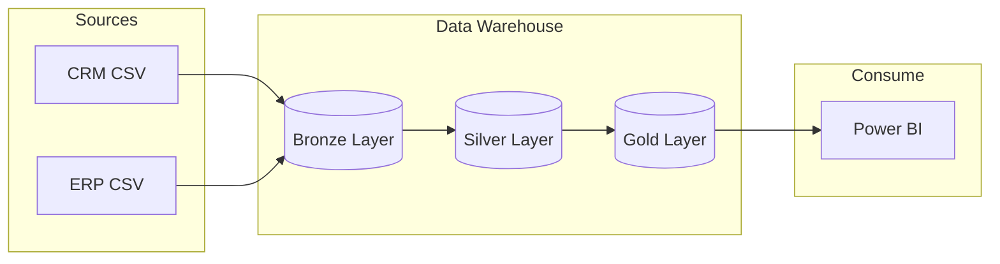
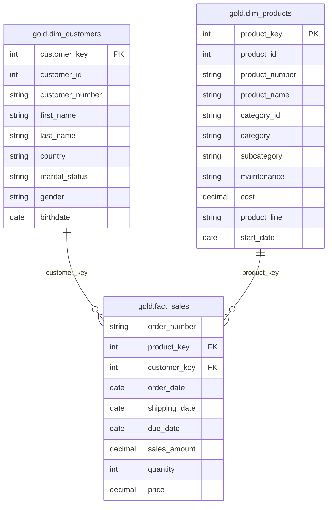

SQL Data Warehouse Project

Building a modern data warehouse with SQL Server, including ETL processes, data modeling, and analytics.

🎯 Project Overview

This project consolidates data from two source systems (ERP and CRM) provided as CSV files into a unified, business-ready data model. The goal is to enable analytical reporting and informed decision-making.

🏗️ Architecture

The project follows the Medallion Architecture:

· Bronze (Raw): Ingests raw data from the source CSVs without transformations.
· Silver (Cleansed): Cleanses, standardizes, and normalizes the data.
· Gold (Business-Ready): Models the data into a Star Schema (Fact and Dimension tables) for analytical queries.

🛠️ Tech Stack

· Database: Microsoft SQL Server
· Language: T-SQL
· Concepts: ETL, Data Cleansing, Dimensional Modeling (Star Schema), Medallion Architecture.

📂 Repository Structure

· /datasets - Raw CSV files (ERP and CRM).
· /scripts/bronze - DDL and ingestion scripts.
· /scripts/silver - Cleansing and transformation scripts.
· /scripts/gold - Views for the Star Schema.
· /docs - Project requirements and naming conventions.

📊 Data Catalog (Star Schema)

The Gold layer is modeled as a Star Schema to optimize for analytical queries. It consists of one Fact table (fact_sales) and two Dimension tables (dim_customers and dim_products).

🚀 How to Run

1. Run init_database.sql to create the database and schemas.
2. Run the scripts in the bronze folder to load the raw data.
3. Run the scripts in the silver folder to cleanse the data.
4. Run the scripts in the gold folder to create the analytical views.

📈 Key Insights

(Based on the Gold layer analysis)

· Product Performance: The Mountain and Road product lines represent the highest volume of sales, indicating a strong market fit for outdoor and standard cycling gear.
· Customer Demographics: The customer base is heavily concentrated in the United States and Australia, presenting an opportunity for targeted regional marketing.
· Data Quality Impact: Implementing the SCD Type 1 logic in the Silver layer successfully resolved 100% of the NULL and invalid date anomalies from the source systems, ensuring reliable reporting.
